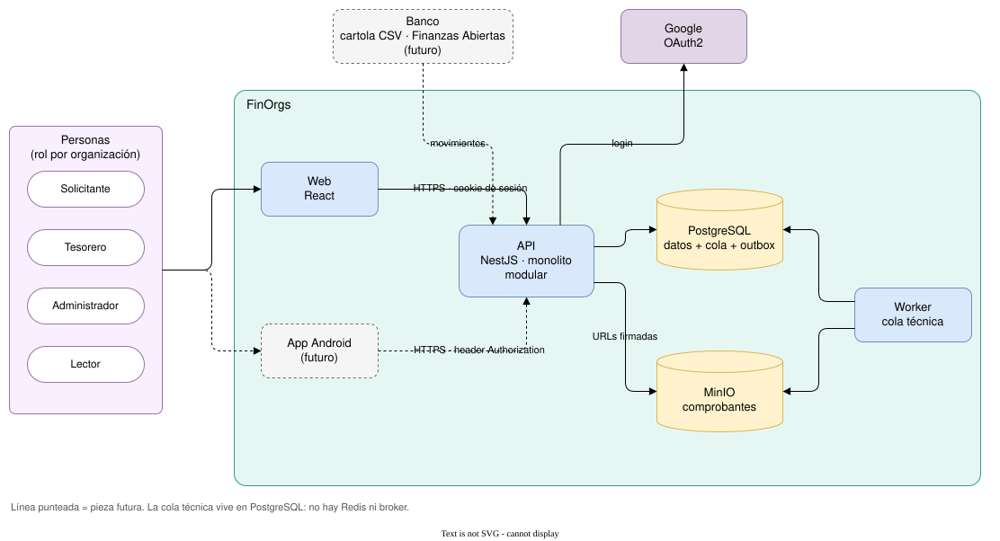

# 1. Contexto del sistema

Quién usa FinOrgs, de qué piezas se compone y con qué sistemas externos habla. Las líneas punteadas son piezas futuras.

> Fuente editable: [01-contexto.drawio](01-contexto.drawio)

## Notas

- **Una persona, varios roles.** El rol vive en la membresía: alguien puede ser tesorero en un club y lector en otro.
- **Web y Android usan la misma sesión del servidor.** Solo cambia cómo viaja: cookie httpOnly en la web, header en Android. El inicio de sesión es con Google (OAuth2) en ambos.
- **La cola técnica vive en PostgreSQL.** No se agrega Redis ni un broker: un servicio menos que operar, y el outbox queda en la misma transacción que el cambio de negocio.
- **El banco es un adaptador.** Hoy entra como cartola CSV. Mañana puede ser un agregador o la API de Finanzas Abiertas, sin tocar el dominio.
