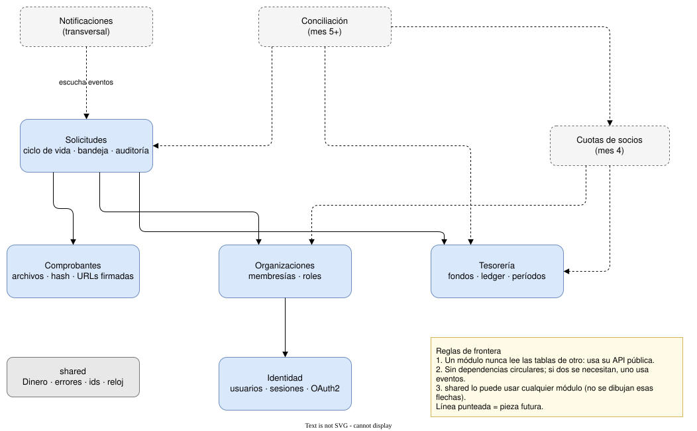

# 2. Módulos del monolito

FinOrgs es un solo despliegue dividido en módulos con fronteras explícitas. La flecha `A → B` significa "A usa a B". Las punteadas son módulos futuros.

> Fuente editable: [02-modulos.drawio](02-modulos.drawio)

`shared` puede usarlo cualquier módulo; para que el diagrama se lea, no se dibujan esas flechas.

## Reglas de frontera

1. **Un módulo nunca lee las tablas de otro.** Le pide lo que necesita a su API pública (un caso de uso o un servicio exportado). Así un módulo se puede rehacer, o separarse algún día, sin romper a los demás.
2. **Las dependencias no forman ciclos.** Si dos módulos se necesitan mutuamente, uno de los dos se comunica por eventos.
3. **`shared` es chico a propósito.** Solo tipos y utilidades sin reglas de negocio: `Dinero`, la base de los errores de dominio, los identificadores y el reloj.

## Por qué estos cortes

- **Tesorería no conoce las solicitudes.** Recibe "registra este pago de X desde el fondo Y" y genera el asiento. Las cuotas y la conciliación también generan movimientos, así que el ledger no puede depender de un solo origen.
- **Comprobantes es su propio módulo.** El almacenamiento, el hash y las URLs firmadas son un problema distinto del ciclo de vida, y las rendiciones de anticipos también van a necesitar comprobantes.
- **Conciliación llegará con un puerto** `FuenteMovimientosBancarios`: la cartola CSV es el primer adaptador, y un agregador o la API de Finanzas Abiertas pueden serlo después sin tocar el dominio.
