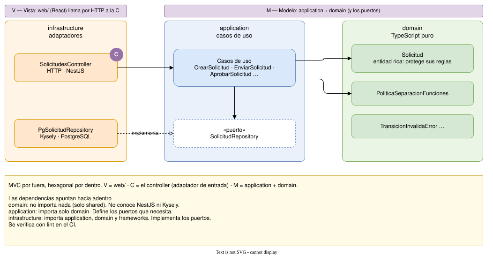

# 3. Capas dentro de un módulo

Cada módulo sigue la misma forma hexagonal. Ejemplo con Solicitudes:



> Fuente editable: [03-hexagonal.drawio](03-hexagonal.drawio)

## MVC por fuera, hexagonal por dentro

MVC organiza la capa de presentación; la arquitectura hexagonal organiza quién depende de quién. No compiten: el controller es el adaptador de entrada.

| MVC | En FinOrgs | Dónde |
|---|---|---|
| **Vista** | La interfaz de la persona: React hoy, Android a futuro | `web/` |
| **Controlador** | Recibe la petición HTTP, valida el formato, llama al caso de uso y arma la respuesta. Sin reglas de negocio | `infrastructure/` de cada módulo |
| **Modelo** | Las reglas y el estado del negocio: entidades, casos de uso y puertos. No son las tablas del ORM | `domain/` y `application/` |

## La regla

**Las dependencias apuntan hacia adentro.**

| Capa | Puede importar | No puede importar |
|---|---|---|
| `domain/` | nada (solo `shared`) | NestJS, Kysely, nada de infraestructura |
| `application/` | `domain/` | NestJS, Kysely, HTTP |
| `infrastructure/` | `application/`, `domain/`, frameworks | — |

Esta regla se verifica con lint en el CI, no con buena voluntad.

## Por qué

- **El dominio se testea sin base de datos ni framework.** La máquina de estados completa se prueba en milisegundos.
- **Las reglas viven en la entidad, no en un servicio gigante.** `solicitud.aprobar(...)` decide si puede aprobarse; el caso de uso solo coordina.
- **Cambiar de adaptador no toca el núcleo.** MinIO por S3 o CSV por Finanzas Abiertas: se escribe un adaptador nuevo que implementa el mismo puerto.

## Estructura de carpetas

```
api/src/modules/solicitudes/
├── domain/           # Solicitud, políticas, errores
├── application/      # casos de uso + puertos
└── infrastructure/   # controller, repositorio Postgres, módulo Nest
```
