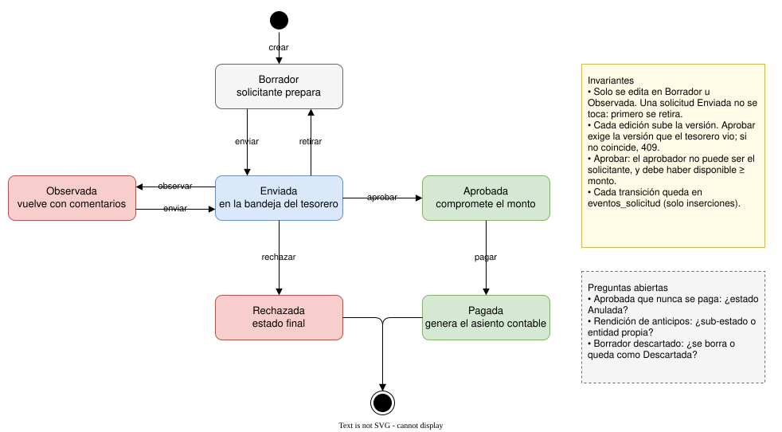

# 4. Ciclo de vida de una solicitud

> Fuente editable: [04-ciclo-solicitud.drawio](04-ciclo-solicitud.drawio)

## Transiciones

| Transición | Quién | Condiciones | Efecto |
|---|---|---|---|
| crear | Solicitante | Membresía activa | Nace en Borrador, versión 1 |
| enviar | Solicitante | Estado Borrador u Observada. Si es reembolso, al menos un comprobante | Entra a la bandeja del tesorero |
| retirar | Solicitante | Estado Enviada | Vuelve a Borrador para corregirla |
| observar | Tesorero | Estado Enviada. Comentario obligatorio | Vuelve al solicitante |
| rechazar | Tesorero | Estado Enviada. Comentario obligatorio | Estado final |
| aprobar | Tesorero | Estado Enviada · **no es el solicitante** · versión = la revisada · disponible ≥ monto | Compromete el monto: baja el disponible, no el saldo |
| pagar | Tesorero | Estado Aprobada · período abierto | Genera el asiento contable y baja el saldo |

Una solicitud Observada se corrige y se reenvía directo a Enviada, sin pasar por Borrador.

## Invariantes

- **Solo se edita en Borrador u Observada.** Una solicitud Enviada no se toca: para cambiarla primero se retira. Así edición y aprobación nunca ocurren sobre el mismo estado.
- **Cada edición sube la versión.** Aprobar exige la versión que el tesorero tenía en pantalla; si no coincide, se responde 409.
- **Cada transición queda en `eventos_solicitud`**, con quién, cuándo, de qué estado a cuál y el comentario. Esa tabla solo admite inserciones.

## Preguntas abiertas

- **Aprobada que nunca se paga.** Si el evento se cancela después de aprobar, ¿cómo se libera el monto comprometido? Probable estado `Anulada` desde Aprobada.
- **Rendición de anticipos.** Un anticipo pagado necesita una rendición posterior y el cálculo de la diferencia a devolver. ¿Es un sub-estado de la solicitud o una entidad propia?
- **¿Puede el solicitante descartar un Borrador?** ¿Se borra o queda como `Descartada` para la auditoría?
