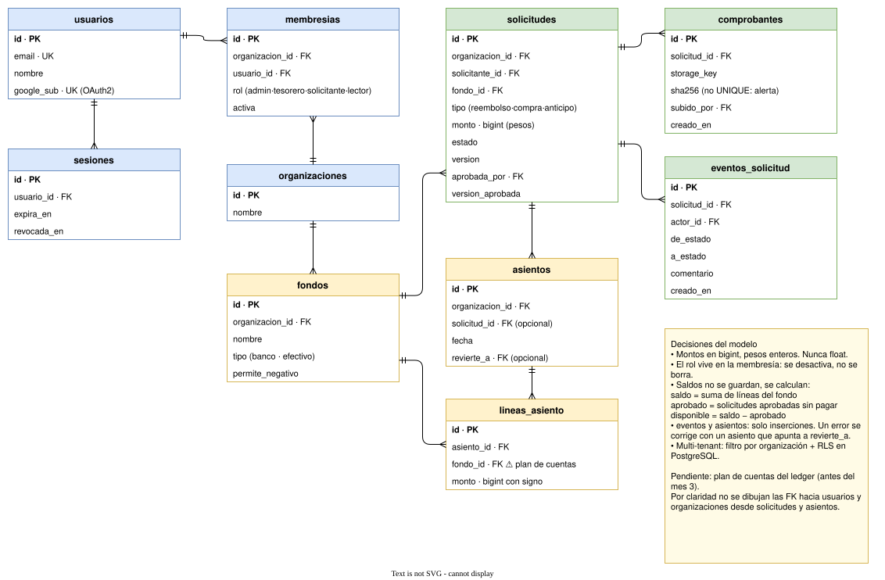

# 5. Modelo de datos del núcleo

Primera vuelta. Las cuotas de socios y la conciliación se agregan después sobre este mismo núcleo.

> Fuente editable: [05-modelo-datos.drawio](05-modelo-datos.drawio)

Por claridad no se dibujan las FK desde `solicitudes` y `asientos` hacia `usuarios` y `organizaciones`; sí figuran como columnas.

## Decisiones del modelo

- **Montos en `bigint`, pesos enteros.** Nunca float.
- **El rol vive en la membresía, no en el usuario.** Al cambiar la directiva se desactiva la membresía en vez de borrarla, y el historial se conserva.
- **Un fondo es una cuenta real de la organización**: bancaria o efectivo (`tipo`).
- **Los saldos no se guardan, se calculan:**
  - **saldo** = suma de las líneas de asiento del fondo
  - **aprobado** = suma de las solicitudes aprobadas y no pagadas del fondo
  - **disponible** = saldo − aprobado
- **`eventos_solicitud` registra cambios de estado; `asientos` registra movimientos de plata.** Ambas tablas solo admiten inserciones. Un error contable se corrige con un asiento nuevo que apunta al original con `revierte_a`.
- **Cada asiento se compone de líneas que suman cero** (doble entrada): lo que sale de un lado entra por otro.
- **Aislamiento multi-tenant en dos capas:** filtro por organización en la aplicación y Row-Level Security en PostgreSQL como respaldo.

## Pendientes

- **Plan de cuentas del ledger (antes del mes 3).** Hoy `lineas_asiento` solo apunta a fondos, y un pago a un gasto no tiene contrapartida para sumar cero. La salida es un plan de cuentas donde los fondos sean un tipo más, junto a gastos, ingresos y otros.
- **Tipo de identificador.** Propuesta: UUID v7, que se ordena por tiempo (bueno para los índices) y no expone cuántos registros hay.
