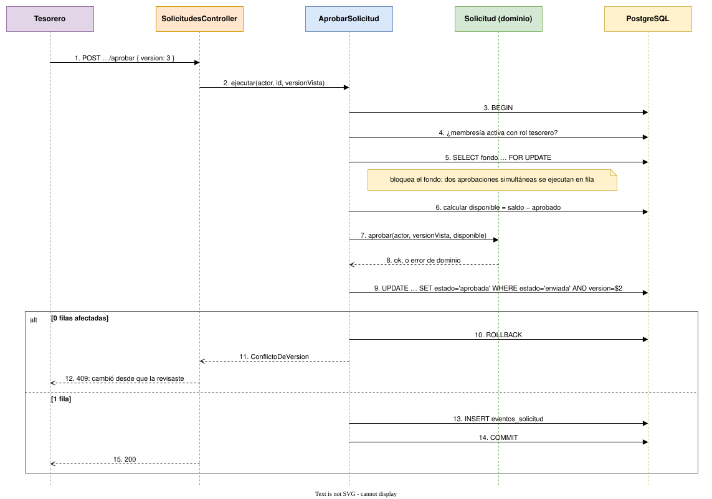

# 6. Secuencia: aprobar una solicitud

El flujo con más reglas y más riesgo de concurrencia. Todo ocurre en **una sola transacción**.

> Fuente editable: [06-aprobar-solicitud.drawio](06-aprobar-solicitud.drawio)

## Qué protege cada paso

| Paso | Riesgo que evita |
|---|---|
| Membresía en la base, en cada petición | Alguien que salió de la directiva y aún tiene la sesión abierta |
| `FOR UPDATE` sobre el fondo | Dos aprobaciones simultáneas que, juntas, superan el disponible |
| `solicitud.aprobar(...)` en el dominio | Aprobarse a sí mismo, saltarse estados, aprobar sin fondos |
| `UPDATE` con `estado` y `version` en el `WHERE` | Aprobar algo que cambió, o aprobar y rechazar a la vez |
| Evento en la misma transacción | Un cambio de estado sin rastro en la auditoría |

Cada fila de esta tabla se convierte en un **test de integración** que dispara dos operaciones en paralelo contra un PostgreSQL real (Testcontainers) y verifica que solo una gana.
